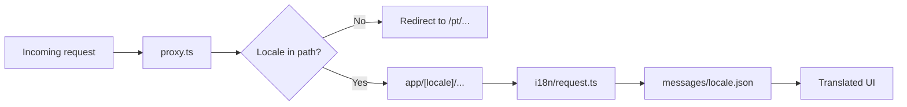

# I18N Architecture

Internationalization structure using `next-intl` with locale-prefixed App Router routes.

## Overview

The site supports four locales: `pt` (default), `en`, `es`, and `fr`.

Every public URL includes a locale prefix:

- `/pt/produtos`
- `/en/produtos`
- `/es/produtos`
- `/fr/produtos`

Route slugs stay in Portuguese across all locales. Only UI copy is translated.

## Stack

- **Library**: `next-intl`
- **Routing**: App Router `[locale]` segment + `proxy.ts`
- **Messages**: JSON files under `messages/`
- **Default locale**: `pt`
- **Locale prefix mode**: `always`

## Folder Structure

```
nosnorte/
├── app/
│   ├── layout.tsx              # Minimal root layout (passes children)
│   ├── not-found.tsx
│   ├── globals.css
│   └── [locale]/
│       ├── layout.tsx          # html/body, providers, Navbar, Footer
│       ├── page.tsx
│       └── …                   # Page routes
├── messages/
│   ├── pt.json
│   ├── en.json
│   ├── es.json
│   └── fr.json
├── i18n/
│   ├── config.ts               # Locales, labels, default locale
│   ├── routing.ts              # defineRouting config
│   ├── request.ts              # getRequestConfig (messages per request)
│   └── navigation.ts           # Locale-aware Link, usePathname, useRouter
└── proxy.ts                    # Locale negotiation and redirects
```

## Request Flow



1. `proxy.ts` negotiates the locale and ensures a prefix is present.
2. The `[locale]` segment provides the active locale to layouts and pages.
3. `i18n/request.ts` loads the matching JSON messages for the request.
4. Server Components use `getTranslations`; Client Components use `useTranslations`.
5. Navigation uses `@/i18n/navigation` so links keep the current locale.

## Message Namespaces

Messages are grouped by concern:

| Namespace | Purpose |
|-----------|---------|
| `common` | Shared UI strings (loading, errors, a11y labels) |
| `navigation` | Navbar labels |
| `footer` | Footer headings, info links, contact labels, copyright |
| `metadata` | Document titles and descriptions |
| `hero` | Homepage hero carousel slide copy (`slides`) |

## Navigation APIs

Import locale-aware navigation from `@/i18n/navigation`, not from `next/link` / `next/navigation`, for in-app routes:

```tsx
import { Link, usePathname, useRouter } from "@/i18n/navigation";
```

`Link` automatically prefixes the active locale. Language switching uses the same pathname with a different `locale` prop.

## Key Files

| File | Role |
|------|------|
| [`i18n/config.ts`](../../i18n/config.ts) | Supported locales and display labels |
| [`i18n/routing.ts`](../../i18n/routing.ts) | Shared routing definition |
| [`i18n/request.ts`](../../i18n/request.ts) | Per-request locale + messages |
| [`i18n/navigation.ts`](../../i18n/navigation.ts) | Locale-aware navigation helpers |
| [`proxy.ts`](../../proxy.ts) | Locale middleware (Next.js 16 proxy) |
| [`global.d.ts`](../../global.d.ts) | Type-safe message keys via `next-intl` `AppConfig` |

## Related

- [I18N Rules](../03-standards/I18N_RULES.md) — mandatory translation conventions
- [Frontend Architecture](FRONTEND_ARCHITECTURE.md) — overall frontend structure
